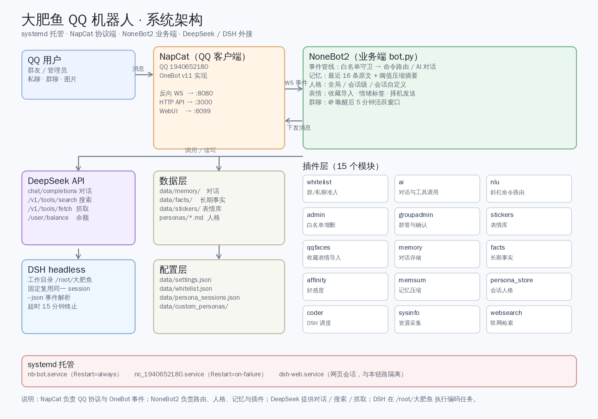

# 花花机器人（huahuaQbot）

一个跑在 Linux 服务器上的 QQ 群聊机器人：**NapCat 负责 QQ 协议，NoneBot2 负责对话与业务，DeepSeek / OpenAI 兼容接口负责大脑**。

她会聊天、发存表情、记事情、管群，还能把写代码的活派给 DSH 在服务器上执行。



---

## 特性

**对话**
- 人格系统：内置「大肥鱼」「傲娇」「狗头军师」，支持全局 / 单会话 / 自定义
- 记忆：最近对话 + 超阈值自动压缩成要点（长期事实单独存，不会被挤掉）
- 好感度：7 档，由模型根据相处自己调整
- 多模态：能看图、看表情包、看视频（抽 3 帧）
- 群聊上下文：被 @ 或唤醒时，自动带上群里最近几条消息
- 人味细节：可沉默、可拒绝、可还嘴、可分条发、可引用、被戳可戳回去

**业务**
- 白名单 / 黑名单：群和人分开管，改动即时生效
- 表情库：从 QQ 收藏一键导入，自动打情绪标签，按语境择机发
- 主动找话：随机时间主动开口，群聊盯 5 分钟看有没有人接，冷场自动退避
- 群管理：踢人、禁言、公告、改名片、设管理员（需要机器人本身是管理员）
- 多模型：一键切换 DeepSeek / GPT 等 OpenAI 兼容服务，菜单式操作
- DSH 集成：`/dsh` 把编码任务派给 agent，在指定目录执行

**运维**
- systemd 托管，`dfy` 一条命令启停整套
- 斜杠命令全部本地解析，不烧模型额度
- 权限三档：主人 / 机器人管理员 / 普通用户
- 密钥不落代码库，`.env` + `data/` 全部 gitignore

---

## 架构

```
QQ 用户
   ↓ 消息
NapCat（QQ 客户端 + OneBot v11）
   ↓ 反向 WebSocket :8080
NoneBot2（bot.py）
   ├─ 插件层：对话、命令、表情、记忆、群管、DSH…
   ├─ DeepSeek / OpenAI 兼容接口（对话 / 搜索 / 余额）
   ├─ DSH headless（在 /root/大肥鱼 执行编码任务）
   └─ 数据层：data/*.json + personas/*.md
```

| 组件 | 作用 |
|---|---|
| NapCat | 登录 QQ，把消息转成 OneBot v11 事件 |
| NoneBot2 | 事件路由、人格、记忆、插件 |
| DeepSeek / GPT | 对话与工具调用的模型 |
| DSH | 收到 `/dsh` 后在本机执行编码任务（独立会话） |

---

## 目录结构

```
bot.py               入口
plugins/             15 个功能模块
personas/            人格提示词（Markdown）
data/                运行时数据（不入库）
  ├─ memory/         对话记忆（按 QQ）
  ├─ memory_summary/ 压缩后的要点
  ├─ facts/          长期事实
  ├─ stickers/       表情库 + index.json
  ├─ whitelist.json  白名单
  ├─ blacklist.json  黑名单
  ├─ admins.json     机器人管理员
  ├─ settings.json   模型 / 接口 / 开关
  └─ providers.json  各家模型服务商
tests/               回归测试
docs/                架构图等
deploy/              systemd 单元与 dfy 脚本
```

---

## 部署

### 1. 系统依赖

```bash
apt update
apt install -y python3 python3-venv ffmpeg fonts-wqy-zenhei xvfb
```

- `ffmpeg`：视频抽帧
- `fonts-wqy-zenhei`：无头环境下 QQ 渲染中文
- `xvfb`：NapCat 需要虚拟显示

### 2. 安装 NapCat + QQ

按官方脚本安装（会自带一个 QQ 客户端）：

```bash
curl -fL -o napcat.sh https://raw.githubusercontent.com/NapNeko/NapCat-Installer/main/script/install.sh
bash napcat.sh --docker n --cli y --github-proxy 0
```

装完后扫码登录一次：

```bash
napcat start <QQ号>
```

首次会输出二维码，用手机 QQ 扫码。二维码也会存到
`/root/Napcat/opt/QQ/resources/app/app_launcher/napcat/cache/qrcode.png`。

### 3. Python 环境

```bash
cd /opt/huahuaQbot        # 或你放代码的位置
python3 -m venv .venv
./.venv/bin/pip install -U pip
./.venv/bin/pip install "nonebot2[fastapi]" nonebot-adapter-onebot httpx pillow
```

### 4. 配置

复制模板并填写：

```bash
cp .env.example .env
```

必填项：

```ini
SUPERUSERS=["你的QQ号"]              # 主人，最高权限
ONEBOT_ACCESS_TOKEN="换成随机串"      # 要和 NapCat 侧一致
DEEPSEEK_API_KEY="sk-xxx"            # 模型密钥
```

然后配置 NapCat 的 OneBot 连接，文件在
`/root/Napcat/opt/QQ/resources/app/app_launcher/napcat/config/onebot11_<QQ号>.json`：

```json
{
  "network": {
    "httpServers": [{
      "enable": true, "host": "127.0.0.1", "port": 3000,
      "token": "换成随机串"
    }],
    "websocketClients": [{
      "enable": true, "url": "ws://127.0.0.1:8080/onebot/v11/ws",
      "token": "换成随机串", "reconnectInterval": 3000
    }]
  }
}
```

两边 token 必须一致，否则连不上。

### 5. systemd

```bash
# 机器人
cp deploy/nb-bot.service /etc/systemd/system/
# NapCat（把 <QQ号> 换成实际号）
cp deploy/nc-napcat.service /etc/systemd/system/nc-<QQ号>.service
systemctl daemon-reload
```

或者直接用自带的 `dfy`：

```bash
cp deploy/dfy /usr/local/bin/dfy && chmod +x /usr/local/bin/dfy
dfy start
```

### 6. 验证

```bash
dfy status
```

正常应该是：

```
NapCat   : active
机器人   : active
登录账号 : 123456789 昵称
✔ WebSocket 已连接
```

然后在 QQ 里私聊机器人发 `/帮助`，能收到菜单就通了。

---

## 常用命令

### 运维

```bash
dfy start | stop | restart | status | log | naplog
```

### QQ 内（私聊或群里）

```
/帮助                     分类菜单
/模型                     切换模型（菜单式，含延迟与余额）
/推理 high|max            推理等级
/白名单 @人 | 群号         准入管理
/黑名单 @人 | 群号
/切换人格 [全局]           人格切换（全局仅主人）
/导入表情 30               从 QQ 收藏导入表情
/主动 on|off              主动找话
/状态                     当前模型、人格、名单、记忆统计
/dsh 任务内容              派活给 DSH（仅主人）
/op @某人                 授权机器人管理员（仅主人）
```

---

## 权限模型

| 角色 | 能做什么 |
|---|---|
| **主人**（`SUPERUSERS`） | 全部，含 `/dsh`、`/接口`、`/余额`、`/op` |
| **机器人管理员**（`/op`） | 模型、人格、白名单、群管、表情；**不能碰服务器** |
| **普通用户** | 聊天、`/帮助`、`/我是谁`、`/好感`、切自己的人格 |

权限判定集中在 `dispatch()` 一处，敏感函数内部再校验一次。

---

## 注意事项

**密钥**
- `.env`、`data/` 已在 `.gitignore`，别手动 `git add -f`
- 聊天里传过的 API key / GitHub token 视为已泄露，用完立刻撤销
- `data/settings.json` 里的 `api_key` 是明文，服务器权限收紧到 600

**QQ 风控**
- 短时间大量发消息可能被限制，分条发送间隔别设太小
- 骂人、脏话、色图评论都可能触发风控，人格里已限制「不带脏字」
- 一个 NapCat 实例只能登一个 QQ，多号要开多实例多端口

**资源**
- NapCat（Electron）常驻约 800MB 内存，机器人本身 100MB 上下
- 模型调用是主要开销，`/主动` 间隔建议 ≥30 分钟
- 视频抽帧用 ffmpeg，单次约 1 秒 CPU

**依赖服务**
- 机器人连不上 NapCat 时，先看 3000/8080 端口和两边 token
- NapCat 重启期间日志里的 `ECONNREFUSED 127.0.0.1:8080` 是正常重连，不用管
- DSH 会话是「独占写」，被占用时会自动开新会话

**升级**
- 升级前先 `dfy stop`，改完代码 `dfy start`
- 人格、白名单、记忆都在 `data/` 和 `personas/`，备份这两个目录即可

---

## 备份

```bash
tar -czf huahua-backup-$(date +%F).tar.gz \
    --exclude='.venv' --exclude='__pycache__' \
    .env data/ personas/
```

恢复时解压回原目录，`dfy start` 即可。

---

## 许可

仅供个人学习与自用。使用 NapCat、QQ 相关能力请遵守腾讯的服务条款，账号风险自负。
